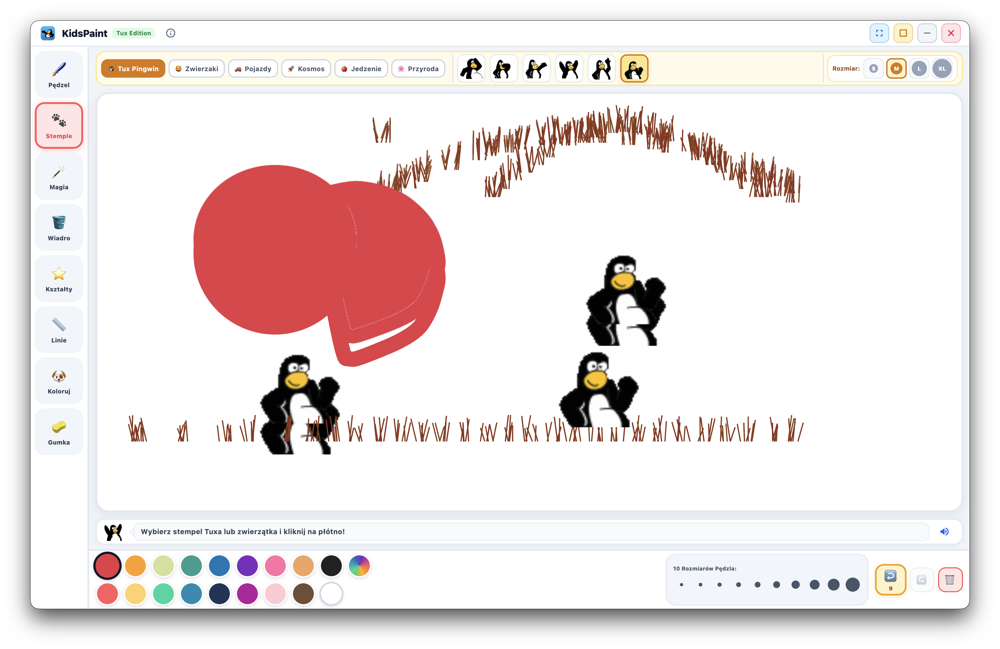

# KidsPaint 🎨🐧

<div align="center">

[](LICENSE)
[](https://flutter.dev)
[](https://flutter.dev)
[-brightgreen)](test/)
[](#-multilanguage--wieloj%C4%99zyczno%C5%9B%C4%87)

**A modern, touch-first children's drawing application inspired by and built upon Tux Paint.**  
*Nowoczesny, przyjazny dotykowo program do rysowania dla dzieci (3+), zainspirowany legendarnym programem Tux Paint.*

[English](#-english) • [Polski](#-polski) • [Credits / Twórcy](#-credits--tw%C3%B3rcy) • [License / Licencja](#-license--licencja)

---



</div>

---

## 🇬🇧 English

### Overview
**KidsPaint** is a multi-platform open-source creative studio built specifically for young children aged 3 and above. It reimagines the beloved classic **Tux Paint** (originally created in 2002 by Bill Kendrick) as a high-performance Flutter application with modern GPU rendering, touch gestures, frameless custom window controls, and full multiplatform support (macOS, iOS, Android, Linux, Windows, Web).

### Key Features
* 🎨 **18 Kid-Friendly Colors:** Large, tactile palette bubbles with a custom rainbow color picker.
* 🖌️ **10 Brush Sizes & 69 Tux Brushes:** From a precise 4 px pencil line to a massive 100 px roller, including authentic Tux Paint brushes with directional rotation, multi-frame sprite sheets, and soft fuzzy edges.
* 🐧 **855 Authentic Tux Stamps:** 6 categories (Tux Penguin, Animals, Vehicles, Food, Space, Plants) with 4 scale presets (**S**, **M**, **L**, **XL**).
* ✨ **10 Magic Effects:** Grass, Rainbow ribbon, Real Rainbow (concentric arc optics), Bricks, Chalk, Blur, Railroad tracks, Foam bubbles, Confetti, and Flowers.
* 🪣 **Smart Flood Fill:** Span-based contiguous raster fill that never leaks outside bounding lines.
* 📐 **Geometric Shapes & Lines:** Circles, squares, triangles, stars (both filled and outline modes) plus rubberband straight lines.
* 📖 **42 Starters & Coloring Books:** Pre-drawn coloring outlines ready for immediate painting.
* ↩️ **Infinite Undo / Redo:** Non-destructive vector action history ("Oops!" and "Redo") without RAM limits.
* 🔊 **Sound Engine:** Authentic Tux Paint sound effects for brushes, tools, stamps, and magic actions, with an instant mute toggle.
* 🌍 **Live Multilanguage:** Instant switching between English, Polish, German, Spanish, French, and Ukrainian.
* 🖥️ **Persistent Window State:** Preserves desktop window size, position, and fullscreen state across sessions.

### Architecture & Tech Stack
* **Framework:** Flutter 3.x / Dart (following the `flutter-ultimate` zero GC churn guidelines).
* **Rendering:** Impeller / Metal GPU-accelerated `CustomPainter` with vector action replay.
* **Audio:** High-performance async sound playback via `audioplayers`.
* **State Management:** `ChangeNotifier`-based reactive state with immutable action history.

### Getting Started

#### Prerequisites
* [Flutter SDK](https://docs.flutter.dev/get-started/install) (3.24+ recommended)
* Xcode (for macOS / iOS), Android Studio (for Android), or platform toolchains (for Linux/Windows).

#### Run locally
```bash
# Clone the repository
git clone https://github.com/PawelSzymanski89/KidsPaint.git
cd KidsPaint

# Fetch dependencies
flutter pub get

# Run tests
flutter test

# Static analysis
flutter analyze

# Launch on your desktop (macOS / Linux / Windows)
flutter run -d macos
```

---

## 🇵🇱 Polski

### O projekcie
**KidsPaint** to otwartoźródłowy, wieloplatformowy program do rysowania i twórczej zabawy, stworzony ze szczególnym uwzględnieniem dzieci od 3. roku życia. Stanowi nowoczesną reinterpretację kultowego programu **Tux Paint** (stworzonego w 2002 roku przez Billa Kendricka), przeniesioną w całości na framework Flutter z akceleracją GPU (Impeller/Metal), natywną obsługą ekranów dotykowych i bezramkowym interfejsem dla wszystkich systemów (macOS, iOS, Android, Linux, Windows, Web).

### Główne funkcjonalności
* 🎨 **Paleta 18 kolorów:** Wielkie, łatwe do kliknięcia pola barwne dostosowane do paluszków dzieci oraz tęczowy próbnik.
* 🖌️ **10 rozmiarów i 69 autentycznych pędzli:** Płynne skalowanie od 4 px do 100 px oraz oryginalne pędzle Tux Painta obsługujące obrót kierunkowy, arkusze klatek (animowane pociągnięcia) i miękkie krawędzie.
* 🐧 **855 stempli Tuxa:** Podział na 6 kategorii (Pingwin Tux, Zwierzątka, Pojazdy, Jedzenie, Kosmos, Przyroda) z 4 rozmiarami (**S**, **M**, **L**, **XL**).
* ✨ **10 narzędzi Magii:** Trawa, Wstęga tęczy, Fizyczna tęcza optyczna, Cegły, Kreda, Rozmycie, Tory kolejowe, Piana mydlana, Konfetti oraz Kwiaty.
* 🪣 **Sprytne Wiaderko (Wypełnianie):** Algorytm span-flood-fill operujący bezpośrednio na rastrze płótna, bez wyciekania poza obrys.
* 📐 **Kształty geometryczne i proste linie:** Koła, kwadraty, trójkąty i gwiazdki (zarówno w wersji z obrysem, jak i wypełnieniem) oraz linie z podglądem na żywo.
* 📖 **42 szkice i kolorowanki:** Gotowe tła i kontury do pokolorowania.
* ↩️ **Nielimitowane Cofnij / Ponów:** Wektorowa historia działań ("Oops!" / "Ponów") bez ograniczeń pamięci RAM.
* 🔊 **Silnik dźwiękowy:** Oryginalne efekty dźwiękowe z Tux Painta przy każdym ruchu pędzla, stemplowaniu i magii (z możliwością natychmiastowego wyciszenia).
* 🌍 **Wielojęzyczność:** Błyskawiczny przełącznik w pasku górnym: polski, angielski, niemiecki, hiszpański, francuski i ukraiński.
* 🖥️ **Zapamiętywanie stanu okna:** Automatyczne przywracanie rozmiaru, pozycji i trybu pełnoekranowego.

### Uruchomienie projektu
```bash
# Pobranie repozytorium
git clone https://github.com/PawelSzymanski89/KidsPaint.git
cd KidsPaint

# Instalacja zależności
flutter pub get

# Uruchomienie testów
flutter test

# Uruchomienie aplikacji na macOS
flutter run -d macos
```

---

## 👥 Credits / Twórcy

### KidsPaint Lead
* **Paweł Szymański** ([@PawelSzymanski89](https://github.com/PawelSzymanski89)) – Project lead, architecture, Flutter rewrite, zero GC rendering engine, multiplatform adaptation, and touch UX.

### Original Tux Paint Project & Attribution
KidsPaint is proud to build upon the legacy of **Tux Paint**, Copyright © 2002–2026 by Bill Kendrick and the Tux Paint community.  
Official website: [https://tuxpaint.org](https://tuxpaint.org) • Organization: New Breed Software.

* **Bill Kendrick** (`bill@newbreedsoftware.com`) – Original Tux Paint Creator & Lead Developer.
* **Albert Cahalan** – Smudge, grass magic tool, brick magic tools, stamp tinter.
* **Andrew 'akanewbie' Corcoran** – Blur, sharpen, chalk, confetti, jigsaw starters (GSoC 2008).
* **Adam 'foo-script' Rakowski** – Confetti, rails, fold, wavelets magic tools (GSoC 2008).
* **Pere Pujal i Carabantes** – Perspective, zoom, mosaic, tornado, label tools.
* **Jeff Newmiller** – Mathematical calculations for Real Rainbow arcs.
* **Damian Yerrick** – Flood fill algorithms.
* **TOYAMA Shin-ichi** – High-resolution graphics maintenance.
* **Tux Paint Artists & Translators** – Contributors of the 855 stamps, brush graphics, starter drawings, sounds, and international translations.

See [`AUTHORS.md`](AUTHORS.md) for full detailed attribution.

---

## 📜 License / Licencja

KidsPaint is free software distributed under the terms of the **GNU General Public License version 2 (GPL-2.0-or-later)**.  
You are free to use, study, modify, and redistribute this software under the terms of the GNU GPL.

*KidsPaint jest wolnym oprogramowaniem udostępnianym na warunkach licencji **GNU General Public License w wersji 2 (GPL-2.0-or-later)**.*

See the [`LICENSE`](LICENSE) file for the full license text.
